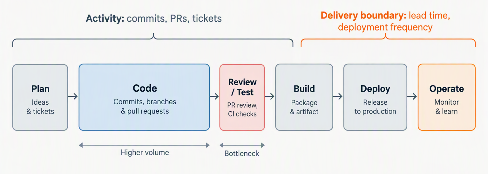

## AI Productivity Myths: Lessons from the Real World #3

*Your AI dashboard is measuring motion. Nobody connected that motion to outcomes anyone outside engineering would recognise as value.*

Last quarter, a director I work with pulled me into a review of their AI adoption metrics. The dashboard was impressive — tool adoption at 92%, commits per developer up 35%, PRs merged per sprint climbing 28%. All green. Very satisfying to look at. But I kept searching for one thing I could not find anywhere in it: "What shipped to production that would not have shipped without this?" Six months of investment, a wall of encouraging numbers, and silence on the only question a business actually needs answered.

I have been watching this pattern repeat across teams. The problem is not that anyone is lying — it is that they are measuring a layer that does not connect to anything outside the engineering org. And I am honestly not sure most people running these dashboards have noticed the gap yet.

## Motion Is Not the Same as Movement

[Previous part](/2026/ai/ai_productivity-mistaking-code-speed-for-delivery-speed/){:target="_blank"} made the case that coding was never where the time went. This post is about what that does to a dashboard.

Earlier this year, a team I worked with adopted AI tools and saw their commit velocity jump 40%. That is the kind of number that looks great in a slide deck. I know because I have seen it in several.

But when I looked at their lead time — ticket creation to production deployment — it had not moved. At all. The activity counter went up and the delivery clock stayed put, because the counter was sitting upstream of the constraint. The dashboard improves. The system sits still.

I should be careful here: I am not arguing all activity metrics are useless. DORA's deployment frequency and lead time for changes *do* correlate with delivery performance — years of research back that up, and I have leaned on those correlations myself. The difference is those metrics sit at the delivery boundary. They measure how fast value reaches users. Commit counts and PR velocity measure internal churn. The problem is not "metrics bad." It is "we picked the wrong layer and called it done."

## The Metrics That Lie to You

Commits, PRs, tickets closed — every one measures motion, not destination. A team can double their PR count while shipping the same user-facing value. They can close more tickets by slicing work thinner without increasing total throughput. More activity in the middle. Same speed at the edges where customers actually feel it.

Adoption rate is worse. McKinsey's 2026 survey makes this uncomfortable, and I do not think the industry has fully sat with it yet. Of [1,719 respondents, only 37% could attribute any EBIT impact to AI](https://www.techtimes.com/articles/325590/20260826/record-ai-spending-cant-move-earnings-needle-94-enterprises-mckinsey-finds.htm){:target="_blank"}. Another 31% saw some impact below the 5% mark, and just 6% cleared it. That 37% is essentially where the 2025 survey landed (39%), a year of heavier investment later. Use is close to universal. Impact is not moving. That gap should alarm people more than it seems to.

Developer satisfaction is the subtlest trap. Part 1 of this series covered the [METR study](https://metr.org/blog/2025-07-10-early-2025-ai-experienced-os-dev-study/){:target="_blank"}, and I should be precise about what survives from it. METR's own February 2026 update says the 19% slowdown probably read low, so I would not quote that number any more. The perception gap is what held up. The developers predicted a 24% speedup, and afterwards still believed they had been around 20% faster. Whatever the true effect was, they could not feel it. When you build a measurement system on satisfaction surveys, you build a system that is structurally blind to certain kinds of failure. I am not sure how you fix that without admitting the satisfaction data alone tells you almost nothing.

And beneath all of this: a [Harness survey](https://www.devopsdigest.com/ai-has-outpaced-how-engineering-organizations-measure-developer-productivity){:target="_blank"} of 700 practitioners and managers, run in April, found 81% say developers spend *more* time in code review since adopting AI coding tools. The generation phase feels productive. Fast. Satisfying. Meanwhile the total cognitive load on the team grows quietly in the background — more to review, more to understand, more surface area for subtle bugs. None of that shows up anywhere a decision-maker would see it.

The best field data I have seen on this comes from a [longitudinal study of an enterprise "2x" mandate](https://arxiv.org/abs/2607.01904){:target="_blank"}: 802 developers and 196,212 pull requests, January 2024 to April 2026. Merged PRs per developer reached 2.09 times the pre-mandate baseline. The activity gain was real and large. Per-reviewer load roughly doubled alongside it, and automated review overtook human review. And here is the part I want to be fair about: merge and revert rates held steady. Quality did not visibly collapse. So the honest reading is not "AI activity is fake". It is that the counter moved, the load moved with it, and the counter alone cannot tell you whether the extra volume was worth carrying. Part 1 made the same point about Microsoft's 24% increase in merged PRs. A bigger number of the same unit is still the same unit.

## What They Did Next

That team with the 40% commit velocity increase did something more interesting than celebrate. They noticed the activity metric had moved but the outcome metric had not, and they treated that gap as a diagnostic signal rather than an inconvenience.

They redirected AI usage toward the actual bottleneck: automated test generation for their integration suite, AI-assisted code review to reduce reviewer load, smaller deployment batches. Their first attempt flopped badly. They pointed Copilot at the integration tests and got a wave of green-path-only cases that passed CI but caught nothing real. The test suite *grew* 40% without improving defect escape rate at all. Forty percent more tests. Zero additional safety. I found that result genuinely instructive.

It took three weeks of pairing with QA — slower, messier work than anyone wanted — to build prompts that generated tests against actual failure modes from their incident log. After that recalibration, lead time actually dropped. The commit count went back *down*, which looked terrible on the old dashboard. Fewer changes, but larger, better-tested, moving through the pipeline cleanly. The metric that mattered — time to deliver value to users — improved by 30%.

That is outcome measurement done right. You do not ask "is the tool being used?" You ask "did the constraint move?"

## The Work That Was Previously Impossible

Here is where my thinking on this shifted. The most valuable thing AI did for another team I work with was not making existing work faster — it was making stuck work *possible*.

They had eighteen months of library upgrades sitting in the backlog. Not because nobody wanted to do them. Everyone agreed the dependencies were a risk — this was not a prioritisation disagreement. But the manual effort was enormous: a three-to-four sprint commitment for updating libraries, fixing breaking changes, rewriting affected tests, validating integration points. Nobody could justify pulling that many people off feature work. So the upgrades sat there, accruing risk, sprint after sprint, while everyone agreed it was important and nobody could make the economics work.

AI changed those economics. What was a quarter's commitment became a two-week campaign. One developer with AI tooling worked through the dependency chain systematically — the mechanical effort that made the work infeasible at human speed became tractable. The libraries got upgraded. The security posture improved. The team moved on. I still think about how long that work sat there.

That is the binary metric worth tracking: *could this team have done this six months ago?* Not faster. Not cheaper. Could they have done it at all? For that library upgrade the answer was no — the economics simply did not justify it before. Now they do.

If you implement one new metric from this post, make it this one. Once a month, ask each team lead: "What did you ship this month that was previously stuck?" Not "what did you do faster" — that is an efficiency question, and efficiency gains are incremental, hard to distinguish from noise. "What did you ship that you *could not have shipped* before?" That is a capability question. The answer tells you whether AI is expanding what your engineering organisation can do, or just making it busier. I am not fully sure how you distinguish the two in every case, but asking the question at all puts you ahead of most.

## The Uncomfortable Question

Here is what I would ask any engineering leader who reports AI success based on activity metrics:

*"If you turned off every AI tool tomorrow and your commit count dropped by 30% — but your deployment frequency, defect rate, and lead time stayed the same — would you say the tools were delivering value?"*

If the honest answer is "no, because the dashboard would look worse" — you are measuring the dashboard, not the engineering. That compounds. Every quarter of investment justified by activity metrics is a quarter where nobody asks whether the investment is actually working. I have watched this happen with other technology investments before — the sunk cost logic takes over, and the dashboard becomes its own justification.

Andrew Diamond, writing in [*Software Engineering in the Age of AI*](https://adiamond.me/2026/06/software-engineering-in-the-age-of-ai/){:target="_blank"}, describes the developer's job shifting from creating to supervising, and asks what person anywhere will have the knowledge to verify that the work the bots are producing is correct. That is the question an activity dashboard cannot ask. It counts what the bots produced. It has no column for whether anyone can vouch for it. The other question, whether you are now doing things you could not do before, is one I would put to every team lead myself. The activity metrics will never answer either. The uncomfortable question — the one nobody wants to ask in front of the dashboard they spent six months building — will.

---

*Next in this series: **Ignoring Selection Bias and the Novelty Effect** — why early AI success stories rarely survive contact with the full engineering population.*

---

**Series: AI Productivity Myths — Lessons from the Real World**
A series examining how engineering leaders misjudge AI coding productivity, based on industry research and real-world enterprise adoption patterns.

---

### References

- McKinsey, [*The State of AI*](https://www.mckinsey.com/capabilities/quantumblack/our-insights/the-state-of-ai){:target="_blank"} (2026 survey, 1,719 respondents), as reported by [Tech Times](https://www.techtimes.com/articles/325590/20260826/record-ai-spending-cant-move-earnings-needle-94-enterprises-mckinsey-finds.htm){:target="_blank"} — 37% attribute any EBIT impact to AI, 31% below the 5% threshold, 6% above it
- He et al., [*AI Writes Faster Than Humans Can Review: A Longitudinal Study of an Enterprise 2x Mandate*](https://arxiv.org/abs/2607.01904){:target="_blank"} (July 2026) — 802 developers, 196,212 PRs; merged PRs per developer at 2.09x baseline, per-reviewer load roughly doubled, merge and revert rates steady
- Harness / DevOps Digest, [*AI Has Outpaced How Engineering Organizations Measure Developer Productivity*](https://www.devopsdigest.com/ai-has-outpaced-how-engineering-organizations-measure-developer-productivity){:target="_blank"} (April 2026 survey, 700 respondents) — 81% say developers spend more time in code review since adopting AI tools
- METR, [*Measuring the Impact of Early-2025 AI on Experienced Open-Source Developer Productivity*](https://metr.org/blog/2025-07-10-early-2025-ai-experienced-os-dev-study/){:target="_blank"} — developers predicted a 24% speedup and afterwards believed they were about 20% faster; the measured 19% slowdown is superseded by METR's [February 2026 update](https://metr.org/blog/2026-02-24-uplift-update/){:target="_blank"}
- Andrew Diamond, [*Software Engineering in the Age of AI*](https://adiamond.me/2026/06/software-engineering-in-the-age-of-ai/){:target="_blank"} — the shift from creation to supervision, and the verification problem it creates
